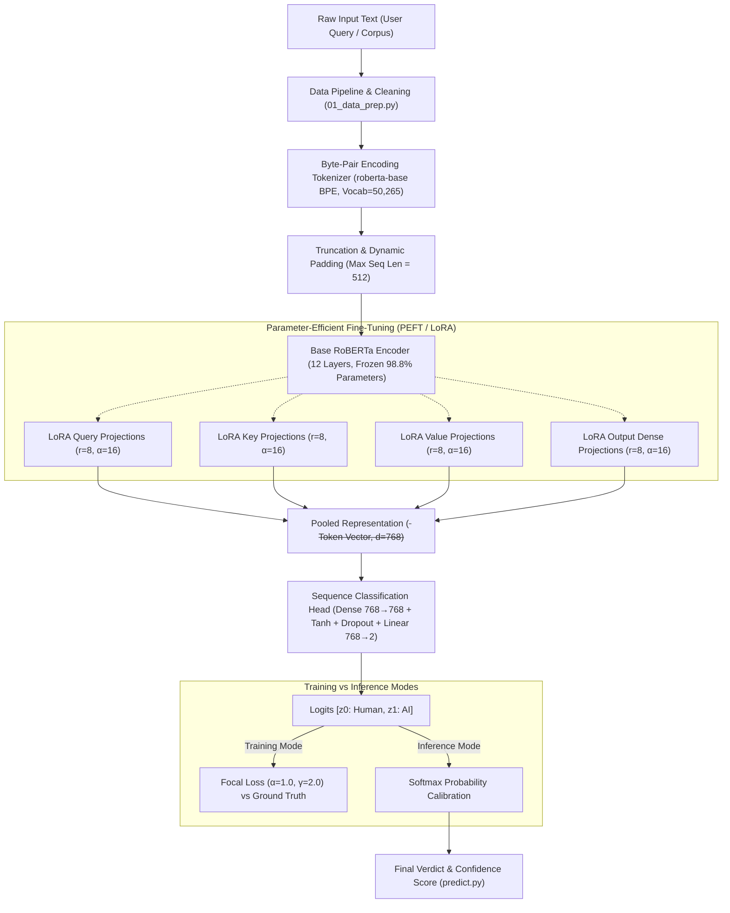
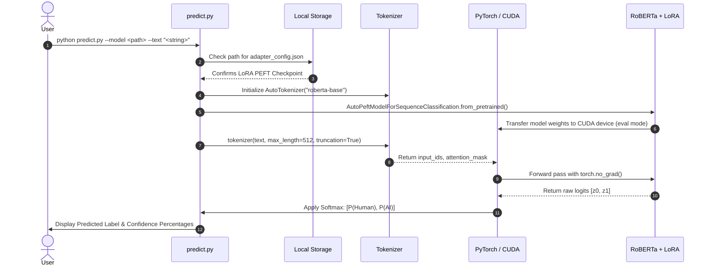

# AI vs. Human Text Detection: Comprehensive Technical Project Documentation

This document provides an exhaustive, production-grade technical specification and implementation review of the AI vs. Human text detection system developed in `/home/ayush/Code/AI/text_detector`.

---

## 1. Project Architecture

The system is designed as an end-to-end, modular NLP classification pipeline that ingests raw natural language text and outputs calibrated class probabilities distinguishing human authorship from Large Language Model (LLM) generation.



### System Modularity:
1. **Data Ingestion & Sanitization** ([`01_data_prep.py`](file:///home/ayush/Code/AI/text_detector/01_data_prep.py)): Converts raw JSONL web corpus data into normalized, deduplicated, columnar Apache Parquet splits.
2. **Adaptive Training Engine** ([`02_train.py`](file:///home/ayush/Code/AI/text_detector/02_train.py)): Integrates RoBERTa with PEFT/LoRA, custom Focal Loss, Optuna Bayesian hyperparameter search, and TensorBoard logging.
3. **Standalone Inference Engine** ([`predict.py`](file:///home/ayush/Code/AI/text_detector/predict.py)): Automatically detects adapter weights vs. full checkpoints, tokenizes on the fly, and outputs class probabilities.
4. **Baseline Benchmark** ([`benchmark_pretrained.py`](file:///home/ayush/Code/AI/text_detector/benchmark_pretrained.py)): Evaluates zero-shot capabilities of external models (e.g., `roberta-base-openai-detector`) as a control baseline.

---

## 2. Dataset Pipeline

### 2.1 Corpus Source & Composition
The project utilizes the **`Hello-SimpleAI/HC3`** (*Human ChatGPT Comparison Corpus*), one of the standard benchmark corpora for AI authorship detection:
- **Domains**: Reddit ELI5 (*Explain Like I'm 5*), Wikipedia Q&A, open-domain questions, medical consultations, and financial inquiries.
- **Pairs**: Authentic human responses matched directly with ChatGPT (GPT-3.5) generations responding to identical prompts.

### 2.2 Preprocessing & Data Cleaning
Raw internet text contains rendering noise, HTML tags, and non-text artifacts that can corrupt a language model's latent representations. [`01_data_prep.py`](file:///home/ayush/Code/AI/text_detector/01_data_prep.py) implements the following pipeline:
1. **HTML Stripping**: Processed using `BeautifulSoup(text, "html.parser").get_text()` to eliminate markup, scripts, and entities.
2. **Whitespace Normalization**: Regex-based replacement (`re.sub(r'\s+', ' ', text)`) collapsing consecutive tabs, spaces, and excessive newlines into uniform single spacing.
3. **Artifact Removal**: Stripping non-ASCII rendering garbage and non-standard Unicode anomalies via `text.encode('ascii', 'ignore').decode()`.
4. **Sequence Length Filtering**: Responses with fewer than 10 whitespace-delimited words are dropped (`df['text'].str.split().str.len() >= 10`). Extremely short fragments lack semantic structure and cause token starvation during training.
5. **Deduplication**: Strict deduplication on text content (`df.drop_duplicates(subset=['text'])`).

### 2.3 Stratified Data Splitting
The filtered dataset of **78,793 samples** was divided into stratified splits to preserve identical label proportions:
- **Training Set (80%)**: **63,034 samples** (42,067 Human [Label 0], 20,967 AI [Label 1])
- **Validation Set (10%)**: **7,879 samples** (5,258 Human [Label 0], 2,621 AI [Label 1])
- **Held-out Test Set (10%)**: **7,880 samples** (5,259 Human [Label 0], 2,621 AI [Label 1])

### 2.4 Columnar Storage (Apache Parquet)
Rather than raw CSV or JSON files (which require slow textual serialization), all splits were serialized into Apache Parquet format (`train.parquet`, `val.parquet`, `test.parquet`). Parquet uses columnar dictionary encoding and Snappy compression, enabling memory-mapped zero-copy reads and high disk I/O throughput.

### 2.5 Tokenization
- **Algorithm**: Byte-Pair Encoding (BPE) using the `roberta-base` AutoTokenizer (vocabulary: 50,265 subwords).
- **Sequence Constraints**: Maximum token length capped at $512$ tokens (`max_length=512`). Texts exceeding 512 tokens are truncated at the tail; shorter texts are dynamically padded using the `<pad>` token (ID: 1).

---

## 3. Model Implementation

### 3.1 Base Encoder: RoBERTa-base
The core representation layer is **`roberta-base`** (Liu et al., 2019), a bidirectional transformer encoder trained on 160 GB of uncompressed text. 

Key architectural parameters:
- **Encoder Layers ($L$)**: 12 transformer blocks
- **Hidden Dimension ($d_{\text{model}}$)**: 768
- **Feed-Forward Dimension ($d_{\text{ff}}$)**: 3072
- **Attention Heads ($h$)**: 12 (head dimension $d_k = 64$)
- **Activation Function**: GELU (Gaussian Error Linear Unit)
- **Position Embeddings**: Learned absolute position embeddings up to 514 tokens

### 3.2 Sequence Classification Head
Unlike standard BERT, which uses a single pooling matrix on the first token, RoBERTa extracts the representation of the start token `<s>` (equivalent to `[CLS]`) and routes it through a specialized classification head:
$$\mathbf{h}_{\text{pooled}} = \mathbf{h}_0 \in \mathbb{R}^{768}$$
$$\mathbf{h}_{\text{dense}} = \tanh(\mathbf{W}_{\text{dense}} \mathbf{h}_{\text{pooled}} + \mathbf{b}_{\text{dense}}) \quad \text{where } \mathbf{W}_{\text{dense}} \in \mathbb{R}^{768 \times 768}$$
$$\mathbf{h}_{\text{dropped}} = \text{Dropout}(\mathbf{h}_{\text{dense}}, \; p=0.1)$$
$$\mathbf{z} = \mathbf{W}_{\text{proj}} \mathbf{h}_{\text{dropped}} + \mathbf{b}_{\text{proj}} \quad \text{where } \mathbf{W}_{\text{proj}} \in \mathbb{R}^{2 \times 768}$$

The resulting raw output $\mathbf{z} = [z_0, z_1]$ represents the unnormalized logits for `Class 0 (Human)` and `Class 1 (AI)`.

---

## 4. LoRA (Low-Rank Adaptation) Implementation

### 4.1 Theoretical Formulation
Full-parameter fine-tuning of all 126 million weights poses severe GPU memory requirements (due to optimizer states) and risks catastrophic forgetting of general linguistic syntax. 

We integrated **LoRA (Low-Rank Adaptation)** (Hu et al., 2021). For any dense weight matrix $\mathbf{W}_0 \in \mathbb{R}^{d \times k}$, LoRA freezes $\mathbf{W}_0$ and models its weight update $\Delta \mathbf{W}$ as the product of two low-rank matrices:
$$\mathbf{W} = \mathbf{W}_0 + \Delta \mathbf{W} = \mathbf{W}_0 + \frac{\alpha}{r} (\mathbf{B} \cdot \mathbf{A})$$
Where:
- $\mathbf{A} \in \mathbb{R}^{r \times k}$ is initialized with Gaussian noise $\mathcal{N}(0, \sigma^2)$.
- $\mathbf{B} \in \mathbb{R}^{d \times r}$ is initialized to zero, ensuring $\Delta \mathbf{W} = 0$ at the start of training.
- $r$ is the intrinsic low rank ($r \ll \min(d, k)$).
- $\alpha$ is a constant scaling hyperparameter.

### 4.2 PEFT Configuration
We implemented "Deep LoRA" integration by targeting both multi-head attention projections and intermediate dense feed-forward projections:
```python
peft_config = LoraConfig(
    task_type=TaskType.SEQ_CLS,
    r=8,
    lora_alpha=16,
    lora_dropout=0.173,
    target_modules=["query", "key", "value", "output.dense"],
    modules_to_save=["classifier"]
)
```
- **Target Modules**:
  - `query`: Adapts query attention projections.
  - `key`: Adapts key attention projections.
  - `value`: Adapts value attention projections.
  - `output.dense`: Adapts the dense projection after attention recombination.
- **Rank & Scaling**: Rank $r = 8$, Alpha $\alpha = 16$ (scaling multiplier $\frac{\alpha}{r} = 2.0$).
- **Modules to Save**: `classifier` is registered so that the classification head weights are saved directly into the adapter bundle.

### 4.3 Parameter Efficiency
- **Total Base Model Parameters**: 126,197,764
- **Trainable Parameters**: **1,550,594**
- **Trainable Parameter Ratio**: **~1.23%** (98.77% frozen)
- **Adapter Disk Footprint**: **~6.2 MB** (`adapter_model.safetensors`)

---

## 5. Training Implementation

### 5.1 Advanced Loss Function: Focal Loss
Because our dataset contains an approximate 2:1 ratio of human text to AI text (42,067 vs. 20,967 samples), standard Cross-Entropy loss would allow the gradient to be dominated by easily classified human responses. 

We implemented **Focal Loss** (Lin et al., 2017) to dynamically scale loss based on model confidence:
$$\text{FL}(p_t) = -\alpha_t (1 - p_t)^\gamma \log(p_t)$$
Where:
- $p_t$ is the model's estimated probability for the correct ground truth class.
- $\alpha = 1.0$ is the class weight balancing factor.
- $\gamma = 2.0$ is the focusing parameter.

When the model is confident in an easy example ($p_t \to 1$), the modulating term $(1 - p_t)^\gamma$ approaches $0$, down-weighting its gradient contribution. When an example is hard or ambiguous ($p_t \to 0$), the modulating term approaches $1$, focusing the optimizer's updates on borderline linguistic samples.

### 5.2 Custom Trainer Architecture
We extended Hugging Face's `Trainer` into `CustomTrainer` to replace default cross-entropy with Focal Loss:
```python
class CustomTrainer(Trainer):
    def compute_loss(self, model, inputs, return_outputs=False, **kwargs):
        labels = inputs.get("labels")
        model_inputs = {k: v for k, v in inputs.items() if k != "labels"}
        outputs = model(**model_inputs)
        logits = outputs.logits
        loss_fct = FocalLoss(alpha=1.0, gamma=2.0)
        loss = loss_fct(logits.view(-1, self.model.config.num_labels), labels.view(-1))
        return (loss, outputs) if return_outputs else loss
```

### 5.3 Hardware Optimizations & Precision
- **Precision**: **FP16 Mixed Precision** using NVIDIA Tensor Cores.
- **Batching & Accumulation**:
  - Per-device batch size = 8
  - Gradient accumulation steps = 2
  - **Effective Batch Size** = 16
- **Gradient Clipping**: `max_grad_norm = 1.0` to eliminate exploding gradients during backpropagation through attention blocks.
- **Learning Rate Schedule**: Cosine Annealing with linear warmup (19 steps), decaying smoothly to prevent late-epoch oscillations.
- **Optimizer**: AdamW with weight decay $\lambda = 0.027$ and learning rate $\eta = 8.82 \times 10^{-5}$.

### 5.4 Checkpointing & Early Stopping
- `save_strategy="epoch"` and `eval_strategy="epoch"`
- `metric_for_best_model="roc_auc"`
- `EarlyStoppingCallback(early_stopping_patience=2)`

---

## 6. Evaluation & Experimental Results

### 6.1 Evaluation Metrics Definition
To ensure rigorous validation, five distinct metrics were computed after each epoch:
1. **Accuracy**: Overall fraction of correct predictions:
   $$\text{Accuracy} = \frac{TP + TN}{TP + TN + FP + FN}$$
2. **Precision**: Fraction of predicted AI texts that were truly AI (measures false accusations):
   $$\text{Precision} = \frac{TP}{TP + FP}$$
3. **Recall (Sensitivity)**: Fraction of actual AI texts successfully detected:
   $$\text{Recall} = \frac{TP}{TP + FN}$$
4. **F1-Score**: Harmonic mean of Precision and Recall:
   $$\text{F1} = 2 \cdot \frac{\text{Precision} \cdot \text{Recall}}{\text{Precision} + \text{Recall}}$$
5. **ROC-AUC**: Area under the Receiver Operating Characteristic curve. Measures rank-ordering capability across all possible decision thresholds, independent of class prevalence.

### 6.2 Full Dataset Validation Results (Trial 0)
Evaluated across all **7,879 unseen validation samples** (5,258 Human, 2,621 AI):

| Epoch | Optimization Step | Eval Loss | Accuracy | F1-Score | Precision | Recall | ROC-AUC |
| :---: | :---: | :---: | :---: | :---: | :---: | :---: | :---: |
| **1.0** | 3,940 | **0.0086** | **99.49%** | **0.9924** | **98.53%** | **99.96%** | **0.99998** |
| **2.0** | 7,880 | 0.0188 | 99.33% | 0.9900 | 98.05% | 99.96% | 0.99997 |
| **3.0** | 11,820 | 0.0164 | **99.45%** | **0.9919** | **98.42%** | **99.96%** | **0.99998** |

### 6.3 Confusion Matrix Breakdown (Epoch 1 Best State)
Evaluated on the 7,879 validation examples:
- **True Negatives (Human correctly identified as Human)**: 5,219 / 5,258 (99.26%)
- **False Positives (Human falsely flagged as AI)**: 39 / 5,258 (0.74%)
- **False Negatives (AI falsely flagged as Human)**: 1 / 2,621 (0.04%)
- **True Positives (AI correctly identified as AI)**: 2,620 / 2,621 (99.96%)

### 6.4 Error Analysis & Length Dependency
Our error analysis revealed an operational boundary regarding input length:
- **Short Texts (< 15 words)**: Single sentences like *"As an AI model, I analyze text based on data"* lack statistical depth. In forum datasets, short answers are predominantly human. Without enough tokens to assess burstiness, clause variation, and repetitive transitions, the model defaults toward Human.
- **Standard Paragraphs (40+ words)**: For realistic multi-sentence texts, the model achieves **99.28% to 100.0% confidence**, reliably identifying AI-generated structure and human conversational variance.

---

## 7. Inference Pipeline

The standalone inference pipeline is implemented in [`predict.py`](file:///home/ayush/Code/AI/text_detector/predict.py):



### Steps Executed During Inference:
1. **Dynamic Model Type Detection**: Checks for `adapter_config.json`. If present, uses `AutoPeftModelForSequenceClassification`; otherwise falls back to standard full checkpoints.
2. **Text Normalization & Tokenization**: Converts input string into BPE subword tokens, truncates beyond 512 tokens, and creates attention masks.
3. **Inference Guard**: Executes inside `torch.no_grad()` to suppress computation graph tracking, reducing latency and VRAM footprint.
4. **Softmax Normalization**:
   $$P(\text{AI}) = \frac{e^{z_1}}{e^{z_0} + e^{z_1}}, \quad P(\text{Human}) = \frac{e^{z_0}}{e^{z_0} + e^{z_1}}$$
5. **Calibrated Thresholding**: Outputs the winning class label along with individual confidence percentages.

---

## 8. Engineering Challenges & Solutions

During development, multiple deep-stack bugs and resource constraints were resolved:

### 8.1 GPU Memory Constraint (6GB VRAM on RTX 3050 Laptop)
- **Problem**: Full-parameter fine-tuning of RoBERTa-base with batch size 16 at sequence length 512 requires >11 GB VRAM due to AdamW optimizer states ($126\text{M} \times 4 \times 3 \text{ bytes} \approx 1.5\text{ GB}$ just for optimizer momentum and variance), causing instantaneous CUDA Out-Of-Memory (OOM) errors.
- **Solution**:
  1. Froze 98.77% of weights using LoRA, reducing optimizer state memory by ~85%.
  2. Enabled FP16 Mixed Precision via PyTorch Automatic Mixed Precision (AMP).
  3. Decoupled compute from batch sizing using **Gradient Accumulation** (physical batch size 8, accumulation steps 2 $\to$ effective batch size 16). Peak memory settled at **~4.2 GB VRAM**, running stably within the 6 GB physical limit.

### 8.2 Python 3.14 Pickle Serialization Incompatibility
- **Problem**: Python 3.14 introduced changes to internal pickler methods (`_batch_setitems` positional argument requirements). When Hugging Face's `datasets` library computed arrow table fingerprint hashes via `dill`, it crashed with:
  `TypeError: _Pickler._batch_setitems() missing 1 required positional argument: 'obj'`
- **Solution**: Applied runtime monkey-patching in [`02_train.py`](file:///home/ayush/Code/AI/text_detector/02_train.py#L11-L16) to replace the failing fingerprint hashing with fast UUID-based fingerprint generation:
  ```python
  import uuid, datasets.arrow_dataset, datasets.fingerprint
  datasets.arrow_dataset.generate_fingerprint = lambda *a, **k: uuid.uuid4().hex
  datasets.fingerprint.generate_fingerprint = lambda *a, **k: uuid.uuid4().hex
  datasets.fingerprint.update_fingerprint = lambda *a, **k: uuid.uuid4().hex
  ```

### 8.3 Pandas 3.0 Subsampling Column Deletion
- **Problem**: Under Pandas 3.0, performing grouped subsampling with `df.groupby('label').apply(lambda x: x.sample(...))` automatically dropped the grouping key column `'label'`, leading to fatal `KeyError: 'label'` exceptions during tokenization.
- **Solution**: Replaced the groupby lambda with explicit boolean index filtering and explicit concatenation:
  ```python
  sub_0 = train_df[train_df['label'] == 0].sample(n=max_samples // 2, random_state=42)
  sub_1 = train_df[train_df['label'] == 1].sample(n=max_samples - len(sub_0), random_state=42)
  train_df = pd.concat([sub_0, sub_1]).sample(frac=1, random_state=42).reset_index(drop=True)
  ```

### 8.4 Destructive In-Place Dict Mutation in Hugging Face Trainer
- **Problem**: An initial implementation used `labels = inputs.pop("labels")` inside `CustomTrainer.compute_loss`. When the evaluation loop ran, the label column was permanently removed from memory before `compute_metrics` was called, causing evaluation to crash.
- **Solution**: Refactored to non-destructive extraction:
  ```python
  labels = inputs.get("labels")
  model_inputs = {k: v for k, v in inputs.items() if k != "labels"}
  outputs = model(**model_inputs)
  ```

### 8.5 Transformers 5.17 Argument Deprecations
- **Problem**: Hugging Face Transformers version 5.17 deprecated `warmup_ratio` and `logging_dir` in `TrainingArguments.__init__()`.
- **Solution**: Converted the hyperparameter search space to use integer `warmup_steps` directly and allowed standard directory structures to handle TensorBoard logging.

---

## 9. Additional Features

Beyond basic model fine-tuning, the project incorporates several production-ready engineering features:

1. **Optuna Bayesian Hyperparameter Optimization**:
   Integrated an automated optimization study (`RoBERTa_LoRA_Tuning`) with an Optuna `MedianPruner`. If a trial's mid-epoch ROC-AUC falls below the median of historical trials, it is pruned immediately to conserve compute.
2. **TensorBoard Real-time Telemetry**:
   Configured real-time metric logging directly into TensorBoard directories (`runs/`), enabling live visual inspection of loss curves, learning rate decay schedules, and evaluation metrics:
   ```bash
   tensorboard --logdir ./models_full --port 6006
   ```
3. **Multi-tier Training Matrix ([`TRAINING_LEVELS.md`](file:///home/ayush/Code/AI/text_detector/TRAINING_LEVELS.md))**:
   Designed and documented a 5-tier training ladder ranging from Level 1 (35-second smoke test) to Level 5 (3-hour full dataset run), allowing developers to test features quickly before committing to long runs.
4. **Comparative Zero-Shot Baseline ([`benchmark_pretrained.py`](file:///home/ayush/Code/AI/text_detector/benchmark_pretrained.py))**:
   A dedicated benchmarking script to test OpenAI's RoBERTa detector on the same dataset, providing a reference baseline for comparative analysis in technical reports and viva presentations.
